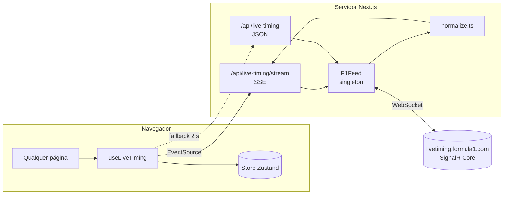
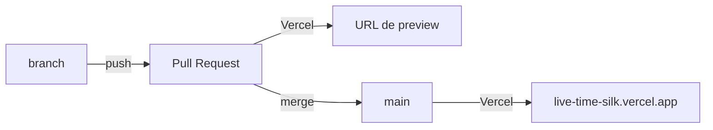

# Apex Timing (Live-Time)

Painel web para acompanhar o **live timing da Fórmula 1 em tempo real**, de graça e sem chave de API: classificação, diferenças, setores, pneus, clima, mensagens do Race Control, calendário da temporada e um mosaico de vídeos (Multiview).

**Site no ar:** [live-time-silk.vercel.app](https://live-time-silk.vercel.app) — publicado automaticamente pela Vercel a cada merge na `main`.

```text
Abra o site  →  o navegador conecta sozinho  →  o servidor fala com a F1  →  dados a cada ~1 s
```

---

## Sumário

- [Destaques](#destaques)
- [Como funciona](#como-funciona)
- [Páginas](#páginas)
- [Tecnologias](#tecnologias)
- [Começando](#começando)
- [Scripts](#scripts)
- [Variáveis de ambiente](#variáveis-de-ambiente)
- [Rotas da API](#rotas-da-api)
- [Estrutura do projeto](#estrutura-do-projeto)
- [Deploy](#deploy)
- [Testes e qualidade](#testes-e-qualidade)
- [Limitações conhecidas](#limitações-conhecidas)
- [Solução de problemas](#solução-de-problemas)
- [Documentação completa](#documentação-completa)
- [Contribuindo](#contribuindo)
- [Aviso legal](#aviso-legal)

---

## Destaques

| | |
| --- | --- |
| **Gratuito** | Usa o feed público de cronometragem da F1 e roda no plano gratuito da Vercel ou da Netlify. |
| **Zero configuração** | Nenhuma variável de ambiente obrigatória. Clonou, publicou, funciona. |
| **Conexão automática** | Qualquer página aberta já conecta ao live timing; não há botão de "conectar". |
| **Tempo real** | Server-Sent Events com no máximo um envio por segundo e só quando algo muda. |
| **Sem servidor extra** | O próprio Next.js abre o WebSocket com a F1 dentro da função serverless. |
| **Resiliente** | Reconecta sozinho após quedas, troca para polling se o streaming falhar e volta ao streaming depois. |
| **Econômico** | Pausa com a aba em segundo plano, fecha a conexão com a F1 sem uso e usa cache de 1 s na CDN. |
| **Testado** | 10 testes automáticos com o estado real da corrida de Singapura 2026 e um hub SignalR falso. |

---

## Como funciona



1. **Abrir o site.** Todas as páginas usam o layout `SectionWorkspace`, que chama o hook `useLiveTiming()`. Ele abre um `EventSource` para `/api/live-timing/stream`.
2. **Conectar à F1.** A rota chama `f1Feed.ensure()`. Se não houver conexão fresca, o servidor faz o negotiate do SignalR, abre o WebSocket em `wss://livetiming.formula1.com/signalrcore` e assina 12 canais (`TimingData`, `DriverList`, `RaceControlMessages`, etc.).
3. **Estado completo.** A F1 responde à assinatura com o estado inteiro da sessão. Por isso, até uma função serverless que acabou de "acordar" já entrega a classificação completa no primeiro evento.
4. **Deltas.** A partir daí a F1 manda só o que mudou. O servidor aplica cada delta em memória (`merge.ts`), converte para um formato estável (`normalize.ts`) e envia ao navegador, agrupando rajadas em no máximo um evento por segundo.
5. **Limite das funções.** Na Vercel uma função pode durar até 300 s no plano Hobby ([documentação](https://vercel.com/docs/functions/limitations)); na Netlify, funções com streaming duram até 60 s ([documentação](https://docs.netlify.com/build/functions/configuration/)). O stream fecha um pouco antes (290 s / 25 s) com o evento `reconnect`, e o navegador reabre em 0,5 s.
6. **Plano B.** Se o stream falhar 3 vezes seguidas, o painel consulta `/api/live-timing` a cada 2 s e tenta o stream de novo após 60 s.
7. **Economia.** Com a aba oculta por 2 minutos, a conexão é pausada; ao voltar, reabre na hora. Sem ninguém assistindo por 90 s, o servidor fecha o WebSocket com a F1.

Entre fins de semana, a F1 mantém o estado da última sessão. A página `/timing` só exibe esses dados se a etapa do feed for a etapa atual do calendário; depois da corrida, passa a mostrar a próxima etapa.

Detalhes: [docs/ARQUITETURA.md](docs/ARQUITETURA.md) e [docs/FEED-F1.md](docs/FEED-F1.md).

---

## Páginas

| Rota | Menu | O que mostra |
| --- | --- | --- |
| `/` | — | Redireciona para `/multiview`. |
| `/multiview` | Multiview | Mosaico de vídeos com 1, 2 ou 4 janelas. Você adiciona URLs de players (iframe); elas ficam salvas no navegador. |
| `/timing` | Live Timing | Cabeçalho da etapa, volta atual/total, status da sessão, temperaturas e quatro abas: **Classificação** (POS, piloto, GAP, intervalo, última, melhor, S1–S3, pneu, voltas), **Setores**, **Pneus** e **Race Control**. |
| `/calendar` | Calendário | Temporadas 2026 (23 etapas) e 2027 (24 etapas), próxima etapa, etapas encerradas e contagem regressiva em dias. |
| `/telemetry` | Telemetria | Pilotos na sessão, melhor volta e cobertura dos dados recebidos. |
| `/race-control` | Race Control | Todas as mensagens da direção de prova, com contagem de críticas e alertas. |
| `/settings` | Conexão | Estado do feed, endpoint, horário do último dado e explicação da conexão automática. |

Na barra superior de todas as páginas: indicador **F1 API · CONECTADA / VERIFICANDO / OFFLINE** (atualizado a cada 10 s) e botão de tema claro/escuro.

Detalhes de cada página, componentes, hooks e store: [docs/FRONTEND.md](docs/FRONTEND.md).

---

## Tecnologias

| Camada | Tecnologia |
| --- | --- |
| Framework | [Next.js](https://nextjs.org) 16 (App Router) |
| UI | React 19, Tailwind CSS 4 + CSS próprio, ícones [lucide-react](https://lucide.dev) |
| Estado | [Zustand](https://zustand.docs.pmnd.rs) 5 |
| Linguagem | TypeScript 5 (estrito) |
| Conexão com a F1 | [ws](https://github.com/websockets/ws) 8 (WebSocket no servidor), protocolo SignalR Core JSON |
| Tempo real no navegador | Server-Sent Events (`EventSource`) |
| Testes | Runner nativo do Node (`node:test`) via [tsx](https://tsx.is) |
| Lint | ESLint 9 + `eslint-config-next` |
| Runtime | Node.js 20.9 ou superior (Docker e Netlify usam 22) |

---

## Começando

### Requisitos

- Node.js **20.9+**
- npm

### Rodar localmente

```bash
git clone https://github.com/AngeloBraga12/Live-Time.git
cd Live-Time
npm install
npm run dev
```

Abra [http://localhost:3000](http://localhost:3000). A conexão com a F1 é aberta na primeira visita.

### Build de produção local

```bash
npm run build
npm start
```

### Conferir se está recebendo dados

```bash
curl -s http://localhost:3000/api/f1-live/status
curl -N http://localhost:3000/api/live-timing/stream
```

---

## Scripts

| Comando | Descrição |
| --- | --- |
| `npm run dev` | Servidor de desenvolvimento com hot reload |
| `npm run build` | Build de produção (inclui checagem de tipos) |
| `npm start` | Serve o build (porta `PORT`, padrão 3000) |
| `npm test` | Executa `tsx --test tests/*.test.ts` |
| `npm run lint` | ESLint |

---

## Variáveis de ambiente

**Nenhuma é obrigatória.** Modelo em [`.env.example`](.env.example); localmente, copie para `.env.local`.

| Variável | Padrão | Para que serve |
| --- | --- | --- |
| `F1_STREAM_SECONDS` | 290 na Vercel, 25 na Netlify, 1800 nos demais | Duração de cada stream SSE antes de o navegador reabrir. Deve ficar abaixo do limite da plataforma. |
| `F1_LIVETIMING_API_URL` | vazio | Usa uma instância externa da f1-livetiming-api em vez da conexão direta (modo `external`). |
| `F1_SIGNALR_URL` | `https://livetiming.formula1.com/signalrcore` | Endereço do hub SignalR. Usado em testes com um hub falso. |
| `PORT` | 3000 | Porta do `npm start`. |

---

## Rotas da API

| Método e rota | Resposta | Cache |
| --- | --- | --- |
| `GET /api/live-timing/stream` | `text/event-stream` com eventos `snapshot`, `offline` e `reconnect`, e `: ping` a cada 15 s | nenhum |
| `GET /api/live-timing` | `{ connected, lastMessageAt, snapshot? }` (502 em erro) | CDN 1 s |
| `GET /api/f1-live/status` | `{ service, mode, connected, status, lastMessageAt, uptimeSeconds, ... }` | CDN 2 s |
| `GET /api/health` | `{ ok: true, site: "up", feed }`, sempre 200 | nenhum |
| `GET /api/calendar` | `{ seasons, events, sources, nextEvent }` | 5 min |

Exemplo de uso do stream:

```js
const source = new EventSource("https://live-time-silk.vercel.app/api/live-timing/stream");
source.addEventListener("snapshot", (event) => {
  const { connected, snapshot } = JSON.parse(event.data);
  if (!connected) return;
  for (const d of snapshot.drivers) console.log(d.position, d.abbreviation, d.gapToLeader, d.tire.compound);
});
```

Formatos completos, exemplos e códigos de status: [docs/API.md](docs/API.md). Todos os campos e regras de conversão: [docs/MODELO-DE-DADOS.md](docs/MODELO-DE-DADOS.md).

---

## Estrutura do projeto

```text
src/
├── app/                       páginas e rotas de API (App Router)
│   ├── api/live-timing/       snapshot JSON e stream SSE
│   ├── api/f1-live/status/    estado da conexão
│   ├── api/health/            health check
│   ├── api/calendar/          calendário
│   ├── multiview/ timing/ calendar/ telemetry/ race-control/ settings/
│   ├── layout.tsx             HTML raiz e tema
│   └── globals.css            estilos e temas
├── components/
│   ├── livetiming/            tabela de classificação, Race Control, mapa
│   ├── multiview/             mosaico de vídeos
│   └── ui/                    layout, status, tema, contagem regressiva
├── data/f1-calendar.ts        calendário 2026 e 2027
├── hooks/                     useLiveTiming, useF1LiveApiStatus, useCalendar
├── lib/f1/
│   ├── feed.ts                cliente SignalR da F1 (conexão, reconexão, ociosidade)
│   ├── merge.ts               aplicação de deltas
│   ├── normalize.ts           conversão para o formato do painel
│   └── source.ts              modo direto ou API externa
├── store/live-timing-store.ts store Zustand
└── types/live-timing.ts       tipos do domínio
tests/                         testes e fixture real
docs/                          documentação detalhada
Dockerfile · fly.toml · render.yaml · netlify.toml
```

---

## Deploy

| Plataforma | Como | Janela do stream |
| --- | --- | --- |
| **Vercel** (em uso) | Importar o repositório em [vercel.com/new](https://vercel.com/new); Next.js é detectado sozinho | 290 s |
| **Netlify** | Importar em [app.netlify.com](https://app.netlify.com); usa o `netlify.toml` | 25 s |
| **Docker** | `docker build -t live-time . && docker run -p 3000:3000 live-time` | 1800 s |
| **Fly.io** | `fly launch --no-deploy --copy-config && fly deploy` (região `gru`) | 1800 s |
| **Render** | New → Blueprint com o `render.yaml` (plano free) | 1800 s |

### Fluxo deste repositório



A integração Git da Vercel está ativa: cada Pull Request ganha uma URL de preview e cada merge na `main` atualiza a produção. **Não faça push direto na `main`**; use branches e Pull Requests.

Passo a passo, Nginx, checklist pós-deploy e dicas de cota: [docs/DEPLOY.md](docs/DEPLOY.md).

---

## Testes e qualidade

```bash
npm test         # 10 testes
npm run build    # build + tipos
npm run lint     # ESLint
```

| Arquivo | Cobre |
| --- | --- |
| `tests/merge.test.ts` | Deltas em listas indexadas, novos stints e mensagens, merge profundo, `_deleted` |
| `tests/normalize.test.ts` | Tempos de volta, sessão, pilotos, Race Control e deltas ao vivo sobre a fixture real |
| `tests/feed.test.ts` | Hub SignalR falso: cookie, negotiate, handshake, assinatura, deltas e reconexão automática |

O lint tem 3 erros e 3 avisos antigos (`set-state-in-effect` em `theme-toggle`, `countdown` e `multiview-console`) que não impedem o build. Detalhes em [docs/DESENVOLVIMENTO.md](docs/DESENVOLVIMENTO.md#lint).

---

## Limitações conhecidas

| Limitação | Motivo |
| --- | --- |
| Sem telemetria de carro (acelerador, freio, marcha) e sem posição no mapa | Os canais `CarData.z` e `Position.z` exigem login de assinante F1 TV. Só a velocidade do speed trap é exibida. |
| Sem replay de sessões passadas | O arquivo estático `livetiming.formula1.com/static` responde HTTP 401. |
| Entre fins de semana, o feed traz a última sessão | Comportamento da F1. O painel compara com o calendário para não mostrar dados velhos como ao vivo. |
| Contagem regressiva só por data | O calendário local não tem os horários das sessões. |
| Calendário é estático | Mudanças de datas exigem editar `src/data/f1-calendar.ts`. |
| Multiview não fornece vídeos | Você precisa adicionar URLs que tem direito de exibir; alguns sites bloqueiam iframe. |
| Contraste baixo de alguns textos do Multiview no tema claro | Pendente de correção. |
| Endpoint da F1 não documentado | A F1 pode mudar o protocolo sem aviso. |
| Na Vercel, cada instância tem sua própria conexão com a F1 | Funções não compartilham memória; aceitável porque cada conexão recebe o estado completo. |

---

## Solução de problemas

| Sintoma | O que fazer |
| --- | --- |
| "Aguardando o início da próxima sessão ao vivo" | Normal fora dos fins de semana. Durante uma sessão, confira se o nome da etapa no calendário bate com `session.meetingName` de `/api/live-timing`. |
| **F1 API · OFFLINE** | Veja `/api/f1-live/status`; o campo `error` explica a falha. |
| Reconexão a cada 25 s ou 290 s | Esperado em serverless (evento `reconnect`). |
| Requisições a `/api/live-timing` a cada 2 s | O site entrou no fallback; volta ao stream em 60 s. |
| Stream sem eventos atrás de Nginx | Use `proxy_buffering off`. |

Guia completo: [docs/SOLUCAO-DE-PROBLEMAS.md](docs/SOLUCAO-DE-PROBLEMAS.md).

---

## Documentação completa

| Documento | Conteúdo |
| --- | --- |
| [docs/ARQUITETURA.md](docs/ARQUITETURA.md) | Camadas, diagramas, ciclo de vida da conexão, SSE, serverless, cache, constantes de tempo, decisões |
| [docs/FEED-F1.md](docs/FEED-F1.md) | Protocolo SignalR da F1 passo a passo, tipos de quadro, canais, merge de deltas |
| [docs/API.md](docs/API.md) | Referência de todas as rotas, com exemplos de resposta |
| [docs/MODELO-DE-DADOS.md](docs/MODELO-DE-DADOS.md) | Tipos TypeScript e regras de conversão campo a campo |
| [docs/FRONTEND.md](docs/FRONTEND.md) | Páginas, componentes, hooks, store, tema, calendário |
| [docs/DEPLOY.md](docs/DEPLOY.md) | Vercel, Netlify, Docker, Fly.io, Render, variáveis, checklist |
| [docs/DESENVOLVIMENTO.md](docs/DESENVOLVIMENTO.md) | Ambiente, testes, lint, convenções e receitas de extensão |
| [docs/SOLUCAO-DE-PROBLEMAS.md](docs/SOLUCAO-DE-PROBLEMAS.md) | Diagnóstico, mensagens de erro e soluções |
| [CONTRIBUTING.md](CONTRIBUTING.md) | Fluxo de branches, PRs e checklist |
| [CHANGELOG.md](CHANGELOG.md) | Histórico de mudanças |

---

## Contribuindo

1. Crie uma branch a partir da `main` (`feat/...`, `fix/...`, `docs/...`).
2. Rode `npm test` e `npm run build`.
3. Abra um Pull Request e confira a URL de preview da Vercel.

Detalhes em [CONTRIBUTING.md](CONTRIBUTING.md).

---

## Aviso legal

Projeto pessoal e não oficial, sem vínculo com a Formula 1, a FIA ou as equipes. "F1", "Formula 1" e marcas relacionadas pertencem aos seus donos. Os dados de cronometragem são da F1 e são exibidos apenas para acompanhamento pessoal; respeite os termos de uso da F1 e dos serviços de vídeo usados no Multiview.

O repositório ainda não define uma licença de código aberto.
