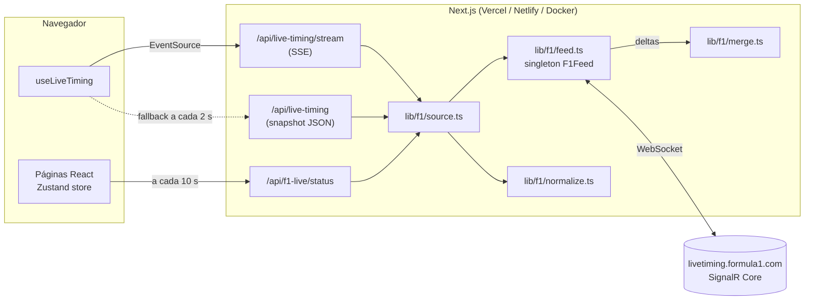
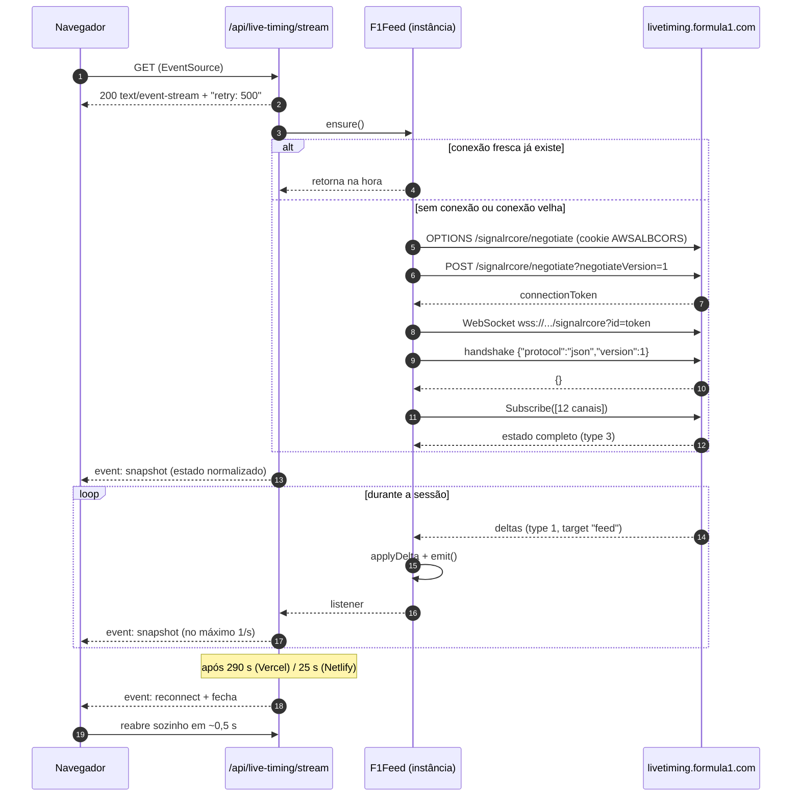

# Arquitetura

Este documento descreve como o Live-Time (Apex Timing) obtém, processa e entrega os dados de live timing da Fórmula 1, e por que ele foi desenhado assim.

> Leitura relacionada: [FEED-F1.md](FEED-F1.md) (protocolo da F1), [API.md](API.md) (rotas HTTP), [MODELO-DE-DADOS.md](MODELO-DE-DADOS.md) (formatos), [FRONTEND.md](FRONTEND.md) (navegador).

## Sumário

- [Visão geral](#visão-geral)
- [Objetivos de design](#objetivos-de-design)
- [Camadas](#camadas)
- [Fluxo de uma visita](#fluxo-de-uma-visita)
- [Ciclo de vida da conexão com a F1](#ciclo-de-vida-da-conexão-com-a-f1)
- [Streaming para o navegador (SSE)](#streaming-para-o-navegador-sse)
- [Comportamento em serverless](#comportamento-em-serverless)
- [Cache na CDN](#cache-na-cdn)
- [Modo externo (f1-livetiming-api)](#modo-externo-f1-livetiming-api)
- [Constantes de tempo](#constantes-de-tempo)
- [Decisões e alternativas descartadas](#decisões-e-alternativas-descartadas)

## Visão geral

Não existe nenhum processo separado. O mesmo servidor Next.js que entrega as páginas também abre o WebSocket com a F1, mantém o estado da sessão em memória e o transmite aos navegadores.

## Objetivos de design

1. **Gratuito.** Rodar no plano Hobby da Vercel (ou no gratuito da Netlify) sem custo e sem chaves de API.
2. **Zero configuração.** Nenhuma variável de ambiente obrigatória; o deploy padrão já funciona.
3. **Conexão automática.** Abrir o site (página inicial) basta para começar a receber dados. O calendário não abre conexão.
4. **Tempo real.** Atualizações a cada ~1 s durante a sessão.
5. **Resiliência.** Recuperar sozinho de quedas de rede, instâncias congeladas, limites de duração das funções e falhas de streaming.
6. **Economia de cota.** Não manter conexões quando ninguém está olhando.

## Camadas

| Camada | Arquivo | Responsabilidade |
| --- | --- | --- |
| Transporte F1 | [`src/lib/f1/feed.ts`](../src/lib/f1/feed.ts) | Negotiate HTTP, WebSocket SignalR, assinatura de canais, recepção de deltas, detecção de conexão morta, reconexão, fechamento por ociosidade. Um único objeto `F1Feed` por instância (guardado em `globalThis`). |
| Merge | [`src/lib/f1/merge.ts`](../src/lib/f1/merge.ts) | Função pura `applyDelta(estado, delta)` que entende listas enviadas como objetos indexados. |
| Normalização | [`src/lib/f1/normalize.ts`](../src/lib/f1/normalize.ts) | Funções puras que convertem o estado bruto da F1 (PascalCase, valores em texto) em `LiveTimingSnapshot`. |
| Origem | [`src/lib/f1/source.ts`](../src/lib/f1/source.ts) | Escolhe entre conexão direta (padrão) e API externa; expõe `getLiveSnapshot`, `getFeedHealth`, `onFeedChange` e `unavailable`. |
| Rotas | [`src/app/api/**/route.ts`](../src/app/api) | HTTP: stream SSE, snapshot, status, health, calendário. |
| Cliente | [`src/hooks/use-live-timing.ts`](../src/hooks/use-live-timing.ts) | EventSource com fallback para polling, pausa em segundo plano. |
| Estado da UI | [`src/store/live-timing-store.ts`](../src/store/live-timing-store.ts) | Store Zustand compartilhada por todas as páginas. |

As camadas de merge e normalização não têm efeitos colaterais nem dependem de rede, o que permite testá-las com um estado real salvo em arquivo (`tests/fixtures/singapore-2026-race.json`).

## Fluxo de uma visita

Na prática, a primeira chamada de uma instância fria paga o custo do negotiate e do estado inicial; as seguintes, na mesma instância, reaproveitam a conexão e respondem quase de imediato.

## Ciclo de vida da conexão com a F1

`F1Feed` é um singleton por instância do servidor (`globalThis.__liveTimeF1Feed`), o que também evita conexões duplicadas com o hot reload do `next dev`.

### `ensure()`

Toda rota que precisa de dados chama `f1Feed.ensure()`:

1. Marca o feed como "em uso" (`touch()`), adiando o fechamento por ociosidade.
2. Se a conexão está **fresca**, retorna imediatamente.
3. Se o socket está aberto mas parece velho, cede um ciclo do event loop (`setImmediate`). Em serverless, uma instância que acabou de "descongelar" pode ter quadros pendentes no socket; isso dá a chance de processá-los antes de decidir reconectar.
4. Caso contrário, abre uma nova conexão. Chamadas simultâneas compartilham a mesma promessa (`this.connecting`), então dez requisições ao mesmo tempo geram uma única conexão.

Uma conexão é considerada **fresca** quando todas as condições abaixo são verdadeiras:

| Condição | Motivo |
| --- | --- |
| `ws.readyState === OPEN` | O socket está aberto. |
| `hasSnapshot` | O estado completo da assinatura já chegou. |
| Último quadro há menos de 30 s (`STALE_AFTER_MS`) | O servidor SignalR manda ping (type 6) a cada ~15 s; 30 s sem nada indica conexão morta. |
| Conexão aberta há menos de 20 min (`RESYNC_AFTER_MS`) | Reassinar periodicamente corrige qualquer delta perdido. |

### Troca de conexão sem buraco

Ao reconectar, a conexão antiga continua aplicando deltas até a nova receber o estado completo. Só então o estado é substituído de uma vez e o socket antigo é encerrado. Deltas que chegam por um socket que não é o atual são ignorados.

### Reconexão automática

Se o socket fecha e **há ouvintes** (streams SSE abertos), o feed agenda `ensure()` em 2 s. Se não há ouvintes, nada é feito: a próxima requisição reconecta sob demanda.

### Fechamento por ociosidade

Sem ouvintes e sem chamadas a `ensure()` por 90 s (`IDLE_CLOSE_MS`), o socket é fechado. Os timers usam `unref()` para não impedir o processo de terminar.

### Estados expostos

`getStatus()` devolve `IDLE` (nunca conectou), `CONNECTING`, `CONNECTED` ou `DISCONNECTED`, além de `lastMessageAt` (último dado recebido, não conta pings), `connectedAt` e `error`.

## Streaming para o navegador (SSE)

A rota [`/api/live-timing/stream`](../src/app/api/live-timing/stream/route.ts) usa Server-Sent Events porque:

- funciona sobre HTTP comum, inclusive em funções serverless com resposta em streaming;
- o `EventSource` do navegador reconecta sozinho, respeitando o campo `retry`;
- o fluxo é unidirecional (servidor → navegador), exatamente o necessário.

Comportamento da rota:

1. Envia `retry: 500` (o navegador espera 0,5 s antes de reabrir).
2. Envia imediatamente um `event: snapshot` com o estado atual.
3. Registra um ouvinte no `F1Feed`. Cada mudança agenda um envio, com **throttle de 1 s**: rajadas de deltas viram uma única mensagem.
4. Evita repetir dados: no modo direto compara a versão do feed (`getVersion()`) e o estado de conexão; no modo externo compara o JSON.
5. A cada 15 s envia o comentário `: ping` (mantém proxies abertos) e agenda uma verificação, que também detecta conexão morta via `ensure()`.
6. Ao fim da janela (`F1_STREAM_SECONDS`), envia `event: reconnect` e fecha.
7. Se o cliente desconecta (`request.signal` abortado ou `cancel()` do stream), todos os timers e ouvintes são limpos.

Janela padrão por plataforma:

| Plataforma | Detecção | Janela | Limite da plataforma |
| --- | --- | --- | --- |
| Vercel | `process.env.VERCEL` | 290 s | 300 s no plano Hobby ([docs](https://vercel.com/docs/functions/limitations)) |
| Netlify | `process.env.NETLIFY` | 25 s | 60 s para funções com streaming ([docs](https://docs.netlify.com/build/functions/configuration/)) |
| Outros (Docker, local) | — | 1800 s | sem limite |

A rota declara `export const maxDuration = 300`, o teto do plano Hobby da Vercel.

## Comportamento em serverless

| Situação | O que acontece |
| --- | --- |
| Primeira visita (função fria) | `ensure()` conecta à F1; o estado completo chega em ~1 s e é devolvido. |
| Várias visitas na mesma instância | Com Fluid Compute, a Vercel reaproveita a instância; todos compartilham o mesmo `F1Feed` e a mesma conexão. |
| Instância congelada entre requisições | Ao acordar, se o último quadro tem mais de 30 s, a conexão é refeita; senão, os quadros pendentes são processados primeiro. |
| Função atinge o tempo máximo | O stream já terá sido encerrado antes, com `reconnect`; o navegador reabre em ~0,5 s. |
| Instâncias diferentes | Cada uma tem sua própria conexão com a F1. Isso é aceitável: a F1 entrega o estado completo para cada uma. |

## Cache na CDN

| Rota | Cabeçalhos | Efeito |
| --- | --- | --- |
| `/api/live-timing` | `Cache-Control: public, max-age=0, s-maxage=1, stale-while-revalidate=4` + `CDN-Cache-Control` equivalente | Vários visitantes no mesmo segundo geram uma execução só. O navegador não guarda cache. |
| `/api/f1-live/status` | `s-maxage=2, stale-while-revalidate=5` | Idem, com 2 s. |
| `/api/calendar` | `max-age=300, stale-while-revalidate=3600` | Calendário muda raramente. |
| `/api/live-timing/stream` | `no-cache, no-store, no-transform` + `X-Accel-Buffering: no` | Streaming nunca é cacheado nem bufferizado. |
| `/api/health` | `no-store` | Sempre reflete o estado real. |

Respostas servidas pelo cache da CDN não executam a função, o que economiza a cota de execuções.

## Modo externo (f1-livetiming-api)

Quando `F1_LIVETIMING_API_URL` está definida, `source.ts` deixa de usar o `F1Feed` e consulta uma instância da f1-livetiming-api (projeto de julesr0y) hospedada à parte:

- `GET {url}/api/status` → estado da conexão;
- `GET {url}/api/leaderboard`, `/api/weather`, `/api/race-control` → dados.

As respostas são convertidas para o mesmo formato bruto do feed (`TimingData.Lines` com as linhas já mescladas, `SessionInfo`, `LapCount`, `WeatherData`, `RaceControlMessages`) e passam pela mesma normalização. Nesse modo o stream SSE consulta a API a cada 1,5 s e só envia quando o JSON muda.

Esse modo existe por compatibilidade com a versão anterior do projeto. A conexão direta é mais rápida e tem mais dados (TrackStatus, SessionStatus, TimingStats).

## Constantes de tempo

| Constante | Valor | Onde |
| --- | --- | --- |
| `CONNECT_TIMEOUT_MS` | 8 s | `feed.ts`: tempo máximo para negotiate e para receber o estado completo |
| `STALE_AFTER_MS` | 30 s | `feed.ts`: sem quadros por esse tempo → conexão morta |
| `RESYNC_AFTER_MS` | 20 min | `feed.ts`: reassinatura periódica |
| `IDLE_CLOSE_MS` | 90 s | `feed.ts`: fecha sem uso |
| Reconexão após queda | 2 s | `feed.ts`: só com ouvintes |
| `THROTTLE_MS` | 1 s | `stream/route.ts`: intervalo mínimo entre envios |
| `KEEPALIVE_MS` | 15 s | `stream/route.ts`: ping SSE e verificação |
| `EXTERNAL_POLL_MS` | 1,5 s | `stream/route.ts`: só no modo externo |
| `retry` SSE | 0,5 s | `stream/route.ts`: espera do navegador antes de reabrir |
| `POLL_MS` | 2 s | `use-live-timing.ts`: intervalo do fallback |
| `MAX_STREAM_FAILURES` | 3 | `use-live-timing.ts`: erros seguidos antes do fallback |
| `STREAM_RETRY_MS` | 60 s | `use-live-timing.ts`: volta a tentar o stream |
| `HIDDEN_PAUSE_MS` | 2 min | `use-live-timing.ts`: pausa com aba em segundo plano |
| Status | 10 s | `use-f1-live-api-status.ts`: polling do indicador do topo |

## Decisões e alternativas descartadas

| Alternativa | Por que não |
| --- | --- |
| Manter a `f1-livetiming-api` como processo separado | Exige um servidor sempre ligado (WebSocket permanente), incompatível com Vercel/Netlify gratuitas. Era a arquitetura anterior do projeto. |
| Conectar o navegador direto na F1 | O negotiate da F1 depende de cabeçalhos (`Origin`, cookie `AWSALBCORS`) que o navegador não deixa definir, e não há CORS liberado. |
| Arquivo estático da F1 (`/static/...`) | Desde 2026 responde HTTP 401 sem login. |
| WebSocket entre navegador e servidor | Funções serverless não mantêm WebSocket de entrada; SSE funciona como resposta HTTP em streaming. |
| Só polling | Funciona (é o fallback), mas gera uma requisição a cada 2 s por visitante e mais latência. |
| Serviço pago de pub/sub (Pusher, Ably etc.) | Contraria o objetivo de custo zero e de não depender de chaves. |
