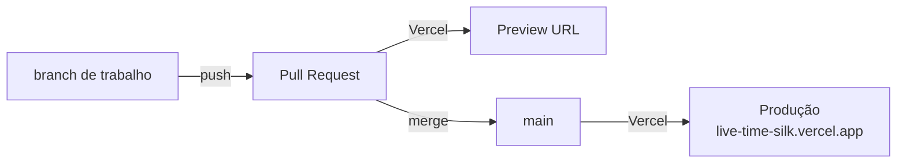

# Deploy

O projeto é um app Next.js comum, sem banco de dados e sem variáveis obrigatórias. O mesmo código roda na Vercel, na Netlify, em Docker, no Fly.io e no Render.

## Sumário

- [Comparativo](#comparativo)
- [Vercel (recomendado)](#vercel-recomendado)
- [Netlify](#netlify)
- [Docker](#docker)
- [Fly.io](#flyio)
- [Render](#render)
- [Variáveis de ambiente](#variáveis-de-ambiente)
- [Checklist pós-deploy](#checklist-pós-deploy)
- [Economia de cota](#economia-de-cota)

## Comparativo

| Plataforma | Custo | Janela do stream | Arquivo | Observação |
| --- | --- | --- | --- | --- |
| Vercel | Hobby gratuito | 290 s | — (detecção automática) | Deploy automático pelo GitHub já configurado |
| Netlify | Gratuito | 25 s | `netlify.toml` | Streams curtos, reabertos pelo navegador |
| Docker | Seu servidor | 1800 s | `Dockerfile` | Conexão contínua |
| Fly.io | Conforme a conta | 1800 s | `fly.toml` | Máquina desliga sem acesso |
| Render | Plano free | 1800 s | `render.yaml` | Hiberna sem acesso |

## Vercel (recomendado)

### Situação atual deste repositório

| Item | Valor |
| --- | --- |
| Projeto | `live-time` (conta `angelobraga12s-projects`) |
| Produção | [live-time-silk.vercel.app](https://live-time-silk.vercel.app) |
| Branch de produção | `main` |
| Deploy automático | Ativo. Cada push na `main` publica em produção; cada Pull Request recebe uma URL de preview, comentada pela Vercel no PR. |

### Fluxo de trabalho



1. Crie uma branch (`git checkout -b feat/minha-mudanca`).
2. Faça push e abra um Pull Request.
3. Confira a URL de preview que a Vercel comenta no PR.
4. Faça o merge; a produção é atualizada em cerca de um minuto.

### Configurar do zero (outro fork ou outra conta)

1. Acesse [vercel.com/new](https://vercel.com/new) e importe o repositório do GitHub. Se ele não aparecer, libere o acesso em GitHub → Settings → Applications → Vercel → Repository access.
2. Framework: **Next.js** (detectado sozinho). Build `npm run build`, output padrão.
3. Não é preciso definir variáveis.
4. Clique em Deploy.

Pela linha de comando:

```bash
npm i -g vercel
vercel          # preview
vercel --prod   # produção
```

### Limites relevantes

- Funções no plano Hobby podem durar até 300 s ([documentação da Vercel](https://vercel.com/docs/functions/limitations)). O stream declara `maxDuration = 300` e fecha sozinho aos 290 s com o evento `reconnect`.
- Respostas do snapshot e do status têm cache de 1–2 s na CDN, então muitos visitantes simultâneos geram poucas execuções.

## Netlify

O [`netlify.toml`](../netlify.toml) já define:

```toml
[build]
  command = "npm run build"
  publish = ".next"

[build.environment]
  NODE_VERSION = "22"
  NEXT_TELEMETRY_DISABLED = "1"
```

Passos:

1. [app.netlify.com](https://app.netlify.com) → Add new site → Import an existing project → GitHub → `Live-Time`.
2. As configurações vêm do `netlify.toml`; o adaptador oficial do Next.js é aplicado automaticamente.
3. Deploy.

Funções com streaming na Netlify duram até 60 s ([documentação da Netlify](https://docs.netlify.com/build/functions/configuration/)). Por isso, quando a variável `NETLIFY` existe, o stream usa janelas de 25 s; o navegador reabre em 0,5 s e o visitante não percebe.

## Docker

O [`Dockerfile`](../Dockerfile) tem duas etapas sobre `node:22-bookworm-slim`:

1. **build**: `npm ci` e `npm run build`;
2. **runtime**: copia o resultado, roda como usuário `node`, expõe a porta 3000, health check em `/api/health` a cada 30 s e inicia com `npm start`.

```bash
docker build -t live-time .
docker run -d --name live-time -p 3000:3000 --restart unless-stopped live-time
# http://localhost:3000
```

Com variáveis:

```bash
docker run -d -p 3000:3000 -e F1_STREAM_SECONDS=600 live-time
```

Atrás de Nginx, desative o buffer para o stream (o servidor já envia `X-Accel-Buffering: no`):

```nginx
location /api/live-timing/stream {
    proxy_pass http://127.0.0.1:3000;
    proxy_http_version 1.1;
    proxy_set_header Connection "";
    proxy_buffering off;
    proxy_read_timeout 1h;
}
```

## Fly.io

O [`fly.toml`](../fly.toml) usa a região `gru` (São Paulo), 512 MB, porta interna 3000, health check em `/api/health` e:

```toml
auto_stop_machines = "stop"
auto_start_machines = true
min_machines_running = 0
```

Ou seja, a máquina para quando ninguém acessa e liga de novo na primeira visita; a conexão com a F1 é refeita sob demanda.

```bash
fly launch --no-deploy --copy-config   # troque o nome "live-time" por um nome único
fly deploy
```

## Render

O [`render.yaml`](../render.yaml) é um Blueprint com um serviço web Docker no plano `free`, health check em `/api/health` e `autoDeploy: true`.

1. [dashboard.render.com](https://dashboard.render.com) → New → Blueprint → selecione o repositório.
2. Confirme. A cada push na branch configurada, o Render publica de novo.

No plano gratuito o serviço hiberna sem acessos; a primeira visita depois disso demora mais (o contêiner precisa acordar) e então conecta à F1 normalmente.

## Variáveis de ambiente

Nenhuma é obrigatória. Modelo em [`.env.example`](../.env.example).

| Variável | Padrão | Descrição |
| --- | --- | --- |
| `F1_STREAM_SECONDS` | 290 (Vercel), 25 (Netlify), 1800 (outros) | Duração de cada stream SSE antes do `reconnect`. Mantenha abaixo do limite da plataforma. |
| `F1_LIVETIMING_API_URL` | vazio | URL de uma f1-livetiming-api externa. Se definida, o site deixa de conectar direto na F1 e passa a consultar essa API (modo `external`). |
| `F1_SIGNALR_URL` | `https://livetiming.formula1.com/signalrcore` | Endereço do hub SignalR. Útil para testes e servidores falsos. |
| `VERCEL`, `NETLIFY` | definidas pelas plataformas | Usadas só para escolher a janela padrão do stream. |
| `PORT` | 3000 | Porta do `next start` (Docker, Fly, Render). |

## Checklist pós-deploy

```bash
BASE=https://live-time-silk.vercel.app

curl -s $BASE/api/health                 # {"ok":true,"site":"up","feed":{...}}
curl -s $BASE/api/f1-live/status         # "connected": true
curl -s $BASE/api/live-timing | head -c 400
curl -N --max-time 5 $BASE/api/live-timing/stream   # retry: 500 e event: snapshot
```

No navegador:

1. Abra `/timing`: o indicador do topo deve mostrar **F1 API · CONECTADA**.
2. Em DevTools → Network, filtre por `stream`: deve haver uma requisição `eventsource` recebendo eventos.
3. Fora de fins de semana, a página mostra a próxima etapa; isso é esperado.

## Economia de cota

O projeto foi pensado para ficar dentro dos planos gratuitos:

- o navegador pausa a conexão depois de 2 min com a aba em segundo plano;
- o servidor fecha o WebSocket com a F1 após 90 s sem uso;
- o stream envia no máximo um evento por segundo e só quando algo muda;
- o snapshot de fallback é cacheado pela CDN por 1 s;
- fora de sessões ao vivo, a F1 não envia deltas, então o stream fica praticamente parado (apenas pings a cada 15 s).

Se a cota da plataforma ficar apertada em fins de semana com muitos acessos, considere hospedar em Docker/Fly.io, onde a conexão é contínua e não há limite de duração.
