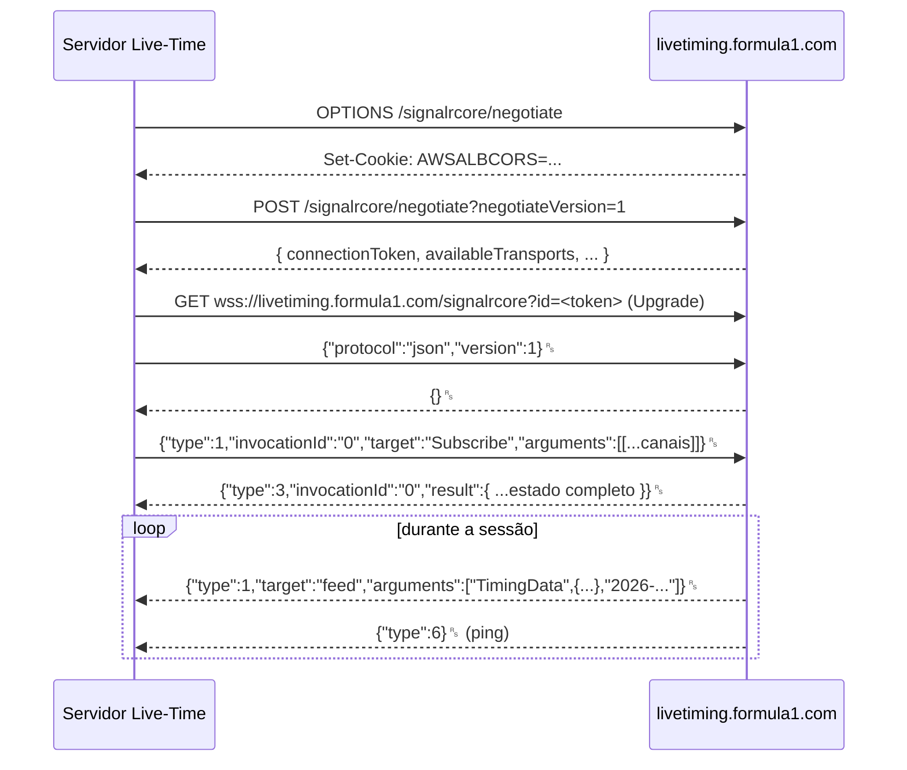

# O feed de live timing da F1

Este documento explica o protocolo usado por [`src/lib/f1/feed.ts`](../src/lib/f1/feed.ts) para receber os dados oficiais de cronometragem da Fórmula 1, a mesma fonte usada pelo app e pelo site oficiais.

> O endpoint não é documentado publicamente pela F1. O que está descrito aqui reflete o comportamento observado e implementado no projeto; a F1 pode mudar o serviço sem aviso.

## Sumário

- [Visão geral](#visão-geral)
- [Passo 1: preflight (cookie)](#passo-1-preflight-cookie)
- [Passo 2: negotiate](#passo-2-negotiate)
- [Passo 3: WebSocket](#passo-3-websocket)
- [Passo 4: handshake](#passo-4-handshake)
- [Passo 5: Subscribe](#passo-5-subscribe)
- [Tipos de quadro](#tipos-de-quadro)
- [Canais assinados](#canais-assinados)
- [Como os deltas são aplicados](#como-os-deltas-são-aplicados)
- [Canais não usados](#canais-não-usados)
- [Comportamento fora dos fins de semana](#comportamento-fora-dos-fins-de-semana)
- [Testando sem a F1](#testando-sem-a-f1)

## Visão geral

O serviço é um hub **ASP.NET SignalR Core** em `https://livetiming.formula1.com/signalrcore`, com protocolo JSON sobre WebSocket. Não exige login para os canais de cronometragem.



O caractere `␞` é o separador de registros ASCII `0x1E`; cada mensagem SignalR termina com ele, e um único quadro WebSocket pode conter várias mensagens.

Todas as requisições levam os cabeçalhos:

```http
User-Agent: BestHTTP
Origin: https://www.formula1.com
```

Sem eles o servidor recusa a conexão. É por isso que o navegador não pode se conectar diretamente: ele não permite definir `Origin` nem `User-Agent`.

## Passo 1: preflight (cookie)

```http
OPTIONS https://livetiming.formula1.com/signalrcore/negotiate
```

O balanceador de carga (AWS ALB) devolve o cookie `AWSALBCORS`, que fixa a conexão em um mesmo servidor de origem. O valor é extraído de `Set-Cookie` e enviado como `Cookie: AWSALBCORS=...` nos passos seguintes. Se o cookie não vier, o fluxo segue sem ele.

## Passo 2: negotiate

```http
POST https://livetiming.formula1.com/signalrcore/negotiate?negotiateVersion=1
Content-Type: text/plain
```

Resposta relevante:

```json
{ "connectionToken": "abc123...", "negotiateVersion": 1, "availableTransports": [ ... ] }
```

Se o negotiate não responder 2xx, o erro é `Negotiate com a F1 falhou (HTTP <código>).`; sem `connectionToken`, é `A F1 não devolveu token de conexão.` Ambos os passos HTTP têm timeout de 8 s.

## Passo 3: WebSocket

```text
wss://livetiming.formula1.com/signalrcore?id=<connectionToken codificado>
```

Aberto com o pacote [`ws`](https://github.com/websockets/ws), com os mesmos cabeçalhos e o cookie. O `ws` é declarado em `serverExternalPackages` no [`next.config.ts`](../next.config.ts) para não ser empacotado pelo bundler.

## Passo 4: handshake

Ao abrir o socket, o cliente envia:

```text
{"protocol":"json","version":1}␞
```

O servidor responde `{}␞` (handshake aceito) ou `{"error":"..."}␞`, caso em que a tentativa falha com `Handshake recusado: ...`. Um erro na resposta do Subscribe gera `Assinatura recusada: ...`.

## Passo 5: Subscribe

Logo após o handshake:

```json
{"type":1,"invocationId":"0","target":"Subscribe","arguments":[["Heartbeat","SessionInfo","SessionStatus","TrackStatus","LapCount","ExtrapolatedClock","DriverList","TimingData","TimingAppData","TimingStats","WeatherData","RaceControlMessages"]]}
```

A resposta é uma mensagem de **conclusão** (`type: 3`) com o mesmo `invocationId: "0"` e o estado completo de todos os canais em `result`. Esse é o momento em que a conexão passa a ser considerada pronta (`hasSnapshot = true`). Se não chegar em 8 s, a tentativa é abortada.

## Tipos de quadro

| `type` | Nome SignalR | Tratamento no projeto |
| --- | --- | --- |
| 1 | Invocation | Se `target === "feed"`: `arguments = [canal, delta, timestamp]`. O delta é aplicado com `applyDelta`, a versão é incrementada e os ouvintes são avisados. |
| 3 | Completion | Com `invocationId "0"`: estado completo da assinatura. Substitui o estado em memória e encerra a conexão anterior, se houver. |
| 6 | Ping | Enviado a cada ~15 s. Só atualiza o horário do último quadro (`lastFrameAtMs`). |
| 7 | Close | O servidor encerrou. O feed fecha o socket com a mensagem de erro recebida. |

Qualquer quadro (inclusive ping) prova que a conexão está viva. Já `lastMessageAt`, exposto na API, só muda quando chegam dados (`type 1` ou `type 3`).

## Canais assinados

| Canal | Conteúdo | Uso no projeto |
| --- | --- | --- |
| `Heartbeat` | Relógio do servidor da F1 | Mantém tráfego; não é exibido. |
| `SessionInfo` | Evento, circuito, país, nome e tipo da sessão (`Type`: `Race`, `Qualifying`, `Practice`), `StartDate`, `GmtOffset` | `session.*`, regra de diferenças (corrida x quali/treino). |
| `SessionStatus` | `Started`, `Finished`, `Finalised`, `Ends`, `Aborted`, `Inactive` | `session.status`. |
| `TrackStatus` | Código de bandeira da pista (1, 2, 4, 5, 6, 7) | `session.trackFlag` e `session.status`. |
| `LapCount` | `CurrentLap`, `TotalLaps` | Contador de voltas. |
| `ExtrapolatedClock` | Relógio restante da sessão | Assinado para futuras funções; não é exibido hoje. |
| `DriverList` | `Tla`, `FullName`, `BroadcastName`, `TeamName`, `TeamColour`, por número do carro | Identidade dos pilotos. |
| `TimingData` | `Position`, `GapToLeader`, `IntervalToPositionAhead`, `LastLapTime`, `BestLapTime`, `Sectors`, `Speeds`, `InPit`, `PitOut`, `Retired`, `Stopped`, `KnockedOut`, `Stats` (por parte de quali), `SessionPart` | Classificação, diferenças, setores, velocidade. |
| `TimingAppData` | `Stints` (`Compound`, `New`, `TotalLaps`) | Pneus. |
| `TimingStats` | `PersonalBestLapTime` | Melhor volta (fallback). |
| `WeatherData` | `AirTemp`, `TrackTemp` (e outros) | Temperaturas. |
| `RaceControlMessages` | `Messages` (`Utc`, `Lap`, `Category`, `Flag`, `Message`, `RacingNumber`, `Sector`) | Race Control. |

O detalhamento de cada conversão está em [MODELO-DE-DADOS.md](MODELO-DE-DADOS.md).

## Como os deltas são aplicados

A F1 envia apenas o que mudou. A regra principal está em [`merge.ts`](../src/lib/f1/merge.ts):

1. **Objetos** são mesclados recursivamente.
2. **Listas** chegam como array no estado completo, mas como **objeto indexado** nos deltas:

   ```json
   // estado completo
   { "Sectors": [ { "Value": "28.713" }, { "Value": "" }, { "Value": "" } ] }
   // delta
   { "Sectors": { "1": { "Value": "38.101", "PersonalFastest": true } } }
   // resultado
   { "Sectors": [ { "Value": "28.713" }, { "Value": "38.101", "PersonalFastest": true }, { "Value": "" } ] }
   ```

   Quando o alvo é um array e todas as chaves do delta são numéricas, o merge atualiza as posições certas em vez de trocar o array por um objeto. Isso vale para `Sectors`, `Stints`, `Messages` de Race Control e similares.
3. **Arrays no delta** substituem o valor anterior por completo.
4. **`_deleted`**: uma lista de chaves a remover (`{ "_deleted": ["44"] }`).
5. **Valores primitivos** substituem o anterior.

Os testes em [`tests/merge.test.ts`](../tests/merge.test.ts) cobrem todos esses casos.

## Canais não usados

| Canal | Por que não |
| --- | --- |
| `CarData.z` (telemetria: acelerador, freio, marcha, RPM) | Exige autenticação de assinante F1 TV. |
| `Position.z` (coordenadas na pista) | Mesmo motivo. |
| `TeamRadio`, `PitLaneTimeCollection`, `TopThree`, `DriverRaceInfo` | Não usados pela interface atual; podem ser acrescentados em `TOPICS` (veja [DESENVOLVIMENTO.md](DESENVOLVIMENTO.md#adicionar-um-canal-da-f1)). |

O arquivo estático de sessões anteriores (`https://livetiming.formula1.com/static/...`) passou a responder HTTP 401, então o projeto não oferece replay de sessões passadas.

## Comportamento fora dos fins de semana

O hub continua aceitando conexões entre os fins de semana e devolve o **estado da última sessão** (por exemplo, a corrida de Singapura até o começo das atividades em Austin). Nenhum delta chega até a próxima sessão, por isso `lastMessageAt` pode ficar dias no passado.

A página inicial usa isso a seu favor: só trata os dados como ao vivo quando `session.meetingName` corresponde à etapa atual do calendário local; fora disso, mostra a próxima etapa no topo e os dados como "Último resultado" (veja [FRONTEND.md](FRONTEND.md#página-ao-vivo)).

## Testando sem a F1

A variável `F1_SIGNALR_URL` troca o endereço do hub. Os testes em [`tests/feed.test.ts`](../tests/feed.test.ts) sobem um servidor SignalR falso local que:

- responde ao `OPTIONS` com um cookie e ao `negotiate` com um token;
- aceita o handshake, responde ao `Subscribe` com o estado de [`tests/fixtures/singapore-2026-race.json`](../tests/fixtures/singapore-2026-race.json);
- envia deltas e verifica se o estado e a versão mudam;
- derruba a conexão e confirma a reconexão automática.

```bash
F1_SIGNALR_URL=http://127.0.0.1:5055/signalrcore npm run dev   # usar um hub próprio
```
