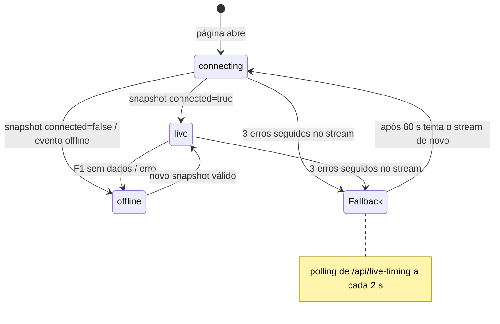
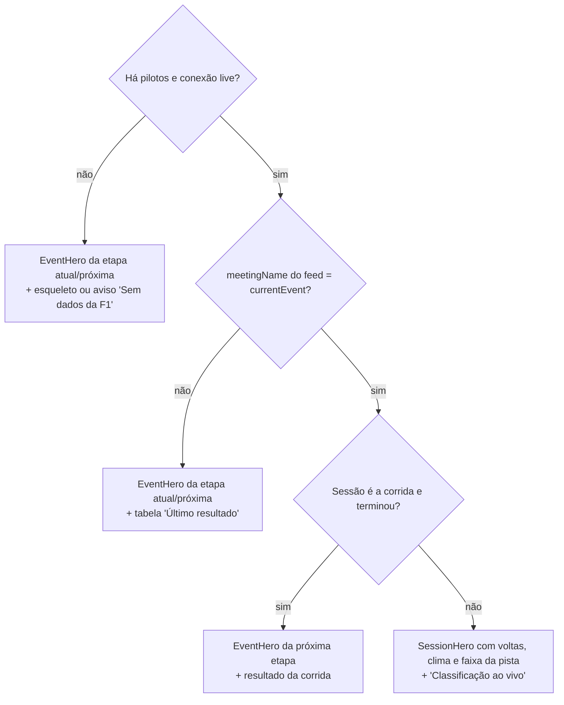

# Frontend

Interface em Next.js 16 (App Router) com React 19, Zustand 5 e ícones lucide-react. Os estilos são CSS puro em um único arquivo ([`src/app/globals.css`](../src/app/globals.css)), sem framework de CSS. A fonte Archivo é servida pelo próprio site via `next/font` (sem requisições a terceiros).

## Sumário

- [Direção visual](#direção-visual)
- [Páginas](#páginas)
- [Estrutura de componentes](#estrutura-de-componentes)
- [Conexão em tempo real](#conexão-em-tempo-real)
- [Store](#store)
- [Hooks](#hooks)
- [Página ao vivo](#página-ao-vivo)
- [Calendário](#calendário)
- [Tema claro e escuro](#tema-claro-e-escuro)
- [Tokens de design](#tokens-de-design)
- [Responsividade](#responsividade)
- [Acessibilidade](#acessibilidade)
- [Dados salvos no navegador](#dados-salvos-no-navegador)
- [Calendário local](#calendário-local)
- [Páginas removidas](#páginas-removidas)

## Direção visual

O design segue a linguagem do site oficial da Fórmula 1:

| Elemento | Como aparece |
| --- | --- |
| Cores | Preto carbono `#15151e` no cabeçalho e no topo das páginas, vermelho F1 `#e10600` só para destaques (aba ativa, selo "Ao vivo", próxima etapa), fundo off-white `#f6f4f1` e superfícies brancas. |
| Tipografia | Archivo variável. Títulos em caixa alta com a largura expandida (`font-stretch: 125%`) e peso 800, lembrando a fonte Formula1 Wide. Texto em largura normal. Números com algarismos tabulares. |
| Cartões | Borda fina só no topo e à direita, com o canto superior direito arredondado (14 px), como os cartões do calendário da F1. |
| Pista | Faixa colorida abaixo do cabeçalho com o estado da pista: verde (pista livre), amarelo (bandeira amarela, safety car, VSC), vermelho (bandeira vermelha) e quadriculado (fim da sessão). |
| Setores | Roxo = melhor da sessão; verde = melhor pessoal (cores padrão da F1). |
| Pneus | Anel na cor do composto (vermelho macio, amarelo médio, branco/cinza duro, verde intermediário, azul chuva) com a letra e a idade em voltas. |

Sem gradientes decorativos, sem ícones em círculos coloridos, sem textos explicando o próprio site.

## Páginas

| Rota | Arquivo | Conteúdo |
| --- | --- | --- |
| `/` | [`src/app/page.tsx`](../src/app/page.tsx) | Ao vivo: cabeçalho da sessão ou da próxima etapa, classificação e direção de prova |
| `/calendar` | [`src/app/calendar/page.tsx`](../src/app/calendar/page.tsx) | Calendário 2026 e 2027 em cartões |

As duas páginas são pré-renderizadas no build (estáticas) e completadas no navegador.

## Estrutura de componentes

```text
app/layout.tsx                    fonte, script de tema, link "Pular para o conteúdo"
├── components/ui/site-header.tsx marca "APEX TIMING", navegação, botão de tema
│   └── components/ui/theme-toggle.tsx
├── <main>
│   ├── app/page.tsx → components/live/live-timing.tsx
│   │   ├── components/live/hero.tsx              SessionHero | EventHero
│   │   ├── components/live/timing-table.tsx      TimingTable | TimingTableSkeleton
│   │   └── components/live/race-control-panel.tsx
│   └── app/calendar/page.tsx → components/calendar/calendar-view.tsx
└── components/ui/site-footer.tsx
```

Funções de formatação (tempos de volta, nomes de sessão em português, estado da pista, datas, nomes de países) ficam em [`src/lib/format.ts`](../src/lib/format.ts).

## Conexão em tempo real

Só a página ao vivo conecta ao live timing: `LiveTiming` chama `useLiveTiming()`. O calendário não abre conexão nenhuma, o que economiza a cota gratuita da hospedagem.



Detalhes do [`use-live-timing.ts`](../src/hooks/use-live-timing.ts):

| Situação | Comportamento |
| --- | --- |
| Página abre | `setConnection("connecting")` e abre `EventSource("/api/live-timing/stream")` |
| Evento `snapshot` | Zera o contador de falhas. O primeiro snapshot válido usa `applySnapshot`; os seguintes, `applyTiming`. Estado vira `live`. |
| Snapshot com `connected: false` ou evento `offline` | Estado vira `offline` (os dados anteriores continuam na store). |
| `onerror` | O fim normal da janela do servidor também dispara `onerror`; o `EventSource` reabre sozinho. Só depois de **3** erros seguidos sem dados (ou se o stream ficar `CLOSED`) cai para polling. |
| Polling | `fetch("/api/live-timing", { cache: "no-store" })` a cada 2 s. Após 60 s, tenta o stream outra vez. |
| Navegador sem `EventSource` | Usa polling direto. |
| Aba em segundo plano por 2 min | Fecha stream e polling. Ao voltar, reabre na hora. |
| `pagehide` (saída da página) | Fecha tudo sem tratar como falha. |

## Store

[`src/store/live-timing-store.ts`](../src/store/live-timing-store.ts) (Zustand):

| Campo / ação | Descrição |
| --- | --- |
| `session` | `SessionInfo` (começa vazio, `status: "scheduled"`) |
| `drivers` | `DriverTiming[]` |
| `raceControl` | `RaceControlMessage[]` |
| `connection` | `"connecting" \| "live" \| "offline"` |
| `lastUpdate` | `emittedAt` do último snapshot |
| `setConnection(c)` | Muda o estado de conexão |
| `applySnapshot(s)` / `applyTiming(s)` | Substituem sessão, pilotos e direção de prova |

Selecione só o necessário para evitar renderizações extras:

```tsx
const drivers = useLiveTimingStore((state) => state.drivers);
```

## Hooks

| Hook | Arquivo | Faz |
| --- | --- | --- |
| `useLiveTiming()` | `use-live-timing.ts` | Conexão em tempo real (acima). Escreve na store. |
| `useCalendar()` | `use-calendar.ts` | Devolve `today` (AAAA-MM-DD em UTC, `null` até montar no navegador), `events` (todas as etapas em ordem), `currentEvent` e `nextAfterToday`. Atualiza a data a cada minuto. |
| `feedMatchesEvent(nome, etapa)` | `use-calendar.ts` | Diz se o nome da etapa do feed corresponde a uma etapa do calendário. |

`today` começa como `null` porque as páginas são geradas no build: a data só é lida no navegador, evitando mostrar a etapa errada ou diferenças de hidratação. Enquanto isso, o cabeçalho mostra um esqueleto de carregamento.

| Valor | Regra |
| --- | --- |
| `currentEvent` | Etapa cujo fim de semana inclui hoje; senão, a próxima a começar |
| `nextAfterToday` | Primeira etapa que começa depois de hoje |

## Página ao vivo

[`components/live/live-timing.tsx`](../src/components/live/live-timing.tsx) decide o que mostrar:



O feed da F1 guarda a última sessão entre um fim de semana e outro. Em vez de esconder esses dados, a página os mostra como **Último resultado**, com o nome da etapa e da sessão.

### Cabeçalho (`hero.tsx`)

| Componente | Quando | Mostra |
| --- | --- | --- |
| `SessionHero` | Feed é da etapa atual e o fim de semana não acabou | Selo **Ao vivo** (se a sessão está rodando), etapa, circuito, nome do GP, sessão em português (Treino Livre 1, Classificação, Sprint, Corrida), volta atual/total (corridas), temperaturas do ar e da pista, e a faixa do estado da pista. |
| `EventHero` | Fora das sessões | Selo **Próxima etapa** ou **Fim de semana em andamento**, etapa e temporada, nome do GP, circuito e cidade, datas e a contagem regressiva em dias, com link para o calendário. |

### Classificação (`timing-table.tsx`)

| Coluna | Some abaixo de | Conteúdo |
| --- | --- | --- |
| Pos | — | Posição |
| Piloto | — | Barra na cor da equipe, sigla; nome e equipe a partir de 560 px; selo **Box** ou **Pit lane** |
| Líder / Intervalo / Diferença | — | Corrida: alterna entre diferença para o líder e intervalo para o carro à frente (botões acima da tabela). Treino e classificação: diferença para o mais rápido. `Líder`, `Abandonou`, `Eliminado` e `Parado` aparecem por extenso. |
| Última | 800 px | Última volta |
| Melhor | 560 px | Melhor volta |
| S1, S2, S3 | 1100 px | Setores, em roxo (melhor da sessão) ou verde (melhor pessoal) |
| Pneu | — | Composto e idade em voltas (o nome completo está no `title` e no `aria-label`) |
| Voltas | 800 px | Voltas completadas |

Enquanto conecta, aparece um esqueleto com 10 linhas. Sem dados, um aviso curto.

### Direção de prova (`race-control-panel.tsx`)

Lista das mensagens (até 50, a mais recente primeiro) com categoria em português (Pista, Incidente, Punição, Pit lane, Clima, Sessão), volta, horário local e um ponto colorido pela severidade (vermelho crítico, amarelo alerta, verde liberação). No desktop fica fixa ao lado da tabela com rolagem própria; abaixo de 1100 px vai para baixo da tabela e mostra 8 mensagens, com o botão **Mostrar mais**.

## Calendário

[`components/calendar/calendar-view.tsx`](../src/components/calendar/calendar-view.tsx):

- título "Calendário 2026" e seletor de temporada (2026, 2027); abre na temporada do ano atual;
- grade de cartões (`auto-fill`, mínimo 260 px) com etapa, datas (`23 – 25 out`), país em português e caixa alta, nome oficial do GP e circuito · cidade;
- a primeira etapa que ainda não terminou fica em **vermelho**, com o selo **Próxima · N dias** ou **Neste fim de semana**;
- etapas passadas mostram **Encerrada**.

## Tema claro e escuro

- O atributo `data-theme="light" | "dark"` fica no `<html>`, aplicado por um script no `<head>` antes da primeira pintura.
- Na primeira visita, segue a preferência do sistema; a escolha fica em `localStorage["apex-theme"]`.
- O botão no cabeçalho ([`theme-toggle.tsx`](../src/components/ui/theme-toggle.tsx)) lê o atributo com `useSyncExternalStore` e um `MutationObserver`.
- O cabeçalho e o topo das páginas são sempre carbono; o tema muda o fundo, as superfícies e o texto.

## Tokens de design

Definidos no início de `globals.css` (`:root` e `html[data-theme="dark"]`):

| Token | Claro | Escuro | Uso |
| --- | --- | --- | --- |
| `--carbon` | `#15151e` | `#15151e` | Cabeçalho, topo das páginas |
| `--red` | `#e10600` | `#e10600` | Destaques |
| `--paper` | `#f6f4f1` | `#0a0a0e` | Fundo da página |
| `--surface` | `#ffffff` | `#17171f` | Tabela, cartões |
| `--surface-2` | `#eeebe6` | `#22222d` | Hover, esqueletos |
| `--ink` | `#15151e` | `#f3f3f5` | Texto principal |
| `--ink-2` | `#4b4b57` | `#c0c0ca` | Texto secundário |
| `--ink-3` | `#686874` | `#9a9aa6` | Rótulos |
| `--red-ink` | `#c00500` | `#ff6257` | Texto vermelho, foco |
| `--purple` / `--green` | `#8a1fcf` / `#00813c` | `#c98bff` / `#3ddc84` | Setores |

Todas as combinações de texto foram medidas com no mínimo 4,5:1 de contraste (WCAG AA) nos dois temas.

## Responsividade

| Largura | Mudanças |
| --- | --- |
| < 1100 px | Direção de prova vai para baixo da tabela; setores somem |
| < 800 px | Cabeçalho em uma coluna; somem Última e Voltas |
| < 560 px | Somem Melhor e o nome completo do piloto; "Timing" sai da marca; botões de diferença ocupam a largura toda |

A página não tem rolagem horizontal em 375 px. Se a tabela não couber, só ela rola na horizontal.

## Acessibilidade

- Link "Pular para o conteúdo" como primeiro item focável.
- Um `<h1>` por página; tabela com `<th scope="col">` e o nome do piloto como `<th scope="row">`.
- Foco visível em vermelho (`:focus-visible`).
- Botões de alternância com `aria-pressed`; "Mostrar mais" com `aria-expanded`; faixa da pista com `role="status"`.
- Animações (pulso do selo e esqueleto) desligadas com `prefers-reduced-motion`.

## Dados salvos no navegador

| Chave | Conteúdo |
| --- | --- |
| `apex-theme` | `"light"` ou `"dark"` |

## Calendário local

[`src/data/f1-calendar.ts`](../src/data/f1-calendar.ts) contém as temporadas 2026 (23 etapas) e 2027 (24 etapas). Cada linha é `[rodada, país, cidade, nome, circuito, início, fim]`; `raceDate` é igual ao último dia.

Para atualizar:

1. Edite ou acrescente as linhas no array do ano.
2. Para um ano novo, inclua-o em `F1_CALENDAR_SOURCES`, `F1_CALENDAR` e `F1_SEASONS`.
3. Use em `name`, `location` e `country` os mesmos termos que a F1 usa no feed (em inglês): a página ao vivo depende disso para reconhecer a etapa. A tradução do país para exibição fica em `countryName()` em `src/lib/format.ts`; acrescente lá países novos.
4. Rode `npm run build` e faça o deploy.

## Páginas removidas

O redesign retirou o que não entregava informação real. As rotas antigas redirecionam para `/` (configurado em [`next.config.ts`](../next.config.ts)):

| Rota antiga | Motivo |
| --- | --- |
| `/multiview` | Mosaico de iframes sem fonte de vídeo; serviços como F1 TV não permitem incorporação. |
| `/timing` | Virou a página inicial `/`. |
| `/telemetry` | A telemetria de carro exige login de F1 TV; a página mostrava quase só "indisponível". |
| `/race-control` | Duplicava a lista que já aparece ao lado da classificação. |
| `/settings` | Mostrava detalhes técnicos da conexão, sem utilidade para quem acompanha a corrida. O estado continua em `/api/f1-live/status`. |
