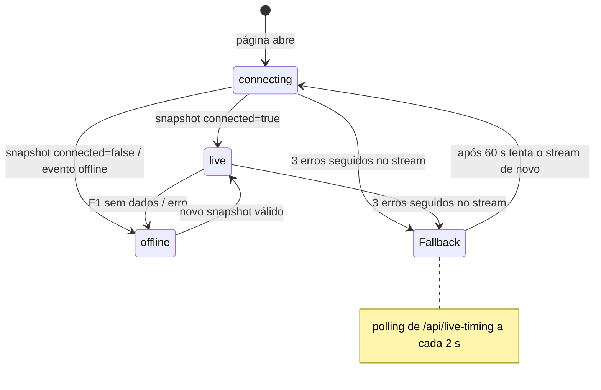

# Frontend

Interface em Next.js 16 (App Router) com React 19, Tailwind CSS 4 (mais CSS próprio em `globals.css`), Zustand 5 e ícones lucide-react. Todas as páginas são componentes de cliente (`"use client"`).

## Sumário

- [Mapa de páginas](#mapa-de-páginas)
- [Layout comum](#layout-comum)
- [Conexão automática](#conexão-automática)
- [Store](#store)
- [Hooks](#hooks)
- [Páginas](#páginas)
- [Componentes](#componentes)
- [Tema claro e escuro](#tema-claro-e-escuro)
- [Dados salvos no navegador](#dados-salvos-no-navegador)
- [Calendário local](#calendário-local)

## Mapa de páginas

| Rota | Arquivo | Menu | Conteúdo |
| --- | --- | --- | --- |
| `/` | `src/app/page.tsx` | — | Redireciona para `/multiview` |
| `/multiview` | `src/app/multiview/page.tsx` | Multiview | Mosaico de vídeos (1, 2 ou 4 janelas) |
| `/timing` | `src/app/timing/page.tsx` | Live Timing | Classificação, setores, pneus e Race Control da sessão |
| `/calendar` | `src/app/calendar/page.tsx` | Calendário | Temporadas 2026 e 2027 com contagem regressiva |
| `/telemetry` | `src/app/telemetry/page.tsx` | Telemetria | Resumo do que o feed publicou |
| `/race-control` | `src/app/race-control/page.tsx` | Race Control | Histórico de mensagens com contagem por severidade |
| `/settings` | `src/app/settings/page.tsx` | Conexão | Estado do feed, endpoint e como a conexão funciona |

## Layout comum

[`SectionWorkspace`](../src/components/ui/section-workspace.tsx) envolve todas as páginas e contém:

- barra lateral com a marca "APEX" e o menu de navegação (o item ativo vem da prop `active`);
- barra superior com o indicador **F1 LIVE** ([`F1LiveApiStatus`](../src/components/ui/f1-live-api-status.tsx)) e o botão de tema ([`ThemeToggle`](../src/components/ui/theme-toggle.tsx));
- título e descrição da seção;
- rodapé `APEX TIMING v0.3 · F1 LIVE TIMING · SIGNALR / SSE · ATUALIZAÇÃO · 1s`.

O `layout.tsx` raiz define `lang="pt-BR"` e um script inline que aplica o tema salvo antes da primeira pintura (evita piscar).

## Conexão automática

`SectionWorkspace` chama `useLiveTiming()`. Como toda página usa esse layout, **qualquer página aberta já conecta ao live timing**, inclusive Multiview e Calendário. Ao trocar de página, a conexão é refeita (o componente é desmontado e montado de novo).



Detalhes do [`use-live-timing.ts`](../src/hooks/use-live-timing.ts):

| Situação | Comportamento |
| --- | --- |
| Página abre | `setConnection("connecting")` e abre `EventSource("/api/live-timing/stream")` |
| Evento `snapshot` | Zera o contador de falhas. O primeiro snapshot válido usa `applySnapshot`; os seguintes, `applyTiming`. Estado vira `live`. |
| Snapshot com `connected: false` ou evento `offline` | Estado vira `offline` (os dados anteriores continuam na store). |
| `onerror` | O fim normal da janela do servidor também dispara `onerror`; o `EventSource` reabre sozinho. Só depois de **3** erros seguidos sem dados (ou se o stream ficar `CLOSED`) cai para polling. |
| Polling | `fetch("/api/live-timing", { cache: "no-store" })` a cada 2 s. Após 60 s, tenta o stream outra vez. |
| Navegador sem `EventSource` | Usa polling direto. |
| Aba em segundo plano por 2 min | Fecha stream e polling para não gastar cota. Ao voltar, reabre na hora. |
| `pagehide` (saída da página) | Fecha tudo sem tratar como falha. |

## Store

[`src/store/live-timing-store.ts`](../src/store/live-timing-store.ts) (Zustand):

| Campo / ação | Descrição |
| --- | --- |
| `session` | `SessionInfo` (começa vazio, `status: "scheduled"`) |
| `drivers` | `DriverTiming[]` |
| `raceControl` | `RaceControlMessage[]` |
| `connection` | `"connecting" \| "live" \| "offline"` |
| `lastUpdate` | `emittedAt` do último snapshot |
| `setConnection(c)` | Muda o estado de conexão |
| `applySnapshot(s)` | Substitui sessão, pilotos e Race Control |
| `applyTiming(s)` | Mesmo efeito; usado nas atualizações seguintes |
| `addRaceControl(m)` | Acrescenta uma mensagem no topo (mantém 10). Não é usado pelo fluxo atual, que já recebe a lista completa. |

Uso típico em componentes, selecionando só o que precisa para evitar renderizações extras:

```tsx
const drivers = useLiveTimingStore((state) => state.drivers);
```

## Hooks

| Hook | Arquivo | Faz |
| --- | --- | --- |
| `useLiveTiming()` | `use-live-timing.ts` | Conexão em tempo real (acima). Não retorna nada; escreve na store. |
| `useF1LiveApiStatus()` | `use-f1-live-api-status.ts` | Consulta `/api/f1-live/status` ao abrir e a cada 10 s. Retorna o `FeedHealth` (ou um estado `CHECKING`/`OFFLINE`). |
| `useCalendar()` | `use-calendar.ts` | Usa o calendário embutido e atualiza por `/api/calendar` ao abrir e a cada 5 min; relógio interno atualizado a cada minuto. Retorna `now`, `calendar`, `seasons`, `currentEvent`, `nextEvent`, `nextAfterToday`. |

Definições do `useCalendar` (datas comparadas em UTC, formato `YYYY-MM-DD`):

| Valor | Regra |
| --- | --- |
| `currentEvent` | Etapa cujo fim de semana inclui hoje; senão a primeira com corrida hoje ou depois |
| `nextEvent` | Primeira etapa com `endDate` hoje ou depois |
| `nextAfterToday` | Primeira etapa que começa depois de hoje |

## Páginas

### Multiview

[`MultiviewConsole`](../src/components/multiview/multiview-console.tsx):

- layouts de **1, 2 ou 4** janelas (padrão 4);
- cada fonte tem nome e URL, e é exibida em um `<iframe>` com `allow="autoplay; fullscreen; picture-in-picture"` e `referrerPolicy="no-referrer"`;
- clicar em uma janela a torna ativa; a nova fonte é atribuída à janela ativa;
- ações por janela: remover, recarregar, tela cheia, maximizar;
- as fontes ficam em `localStorage["apex-multiview-feeds"]`; a atribuição janela→fonte não é salva.

O projeto não fornece fontes de vídeo. Use apenas URLs que você tem direito de exibir (por exemplo, players incorporáveis do seu serviço de streaming).

### Timing

A página principal de cronometragem, com quatro abas:

| Aba | Componente | Mostra |
| --- | --- | --- |
| Classificação | [`LiveTimingTable`](../src/components/livetiming/live-timing-table.tsx) | Colunas POS, PILOTO (faixa na cor da equipe), GAP, INTERVALO, ÚLTIMA, MELHOR, S1, S2, S3, PNEU e VOL. Clique em um piloto para selecioná-lo. |
| Setores | `SectorTable` (na própria página) | POS, PILOTO, S1, S2, S3 e MELHOR VOLTA, com destaque para melhor da sessão e melhor pessoal |
| Pneus | `TyreTable` | POS, PILOTO, COMPOSTO (S, M, H, I, W), IDADE, VOLTAS e SITUAÇÃO (novo/usado) |
| Race Control | [`RaceControlTicker`](../src/components/livetiming/race-control-ticker.tsx) | Mensagens da direção de prova; a aba exibe a quantidade |

Faixa de resumo: volta atual / total com barra de progresso, status da sessão ([`StatusPill`](../src/components/ui/status-pill.tsx)), temperaturas do ar e da pista.

#### Regra de exibição

O feed da F1 mantém a última sessão entre um fim de semana e outro. Para não mostrar dados velhos como se fossem ao vivo:

1. O nome da etapa no feed (`session.meetingName`, sem acentos e em minúsculas) é comparado com nome, cidade e país do `currentEvent` do calendário (apenas termos com mais de 3 letras).
2. Só se houver correspondência **e** a conexão estiver `live`, a página mostra pilotos e Race Control (`showFeedSession`). Isso inclui sessões já encerradas do mesmo fim de semana (por exemplo, o resultado do TL1 até o TL2 começar).
3. Se a sessão exibida for a **corrida** e estiver encerrada, o cabeçalho passa a apresentar a **próxima etapa** (`nextAfterToday`).
4. Sem correspondência, a página mostra a etapa do calendário com "Aguardando o início da próxima sessão ao vivo...".

### Calendário

- seletor de temporada (2026 e 2027);
- lista de etapas com rodada, país, circuito e datas formatadas em pt-BR por `formatWeekend` (por exemplo `23 OUT. — 25 OUT. 2026`);
- etapas marcadas como **PRÓXIMA** ou **ENCERRADA**;
- [`Countdown`](../src/components/ui/countdown.tsx): dias até o próximo fim de semana, ou "FIM DE SEMANA EM ANDAMENTO". A contagem é só por data, pois os horários exatos das sessões não estão no calendário local.

### Telemetria

Resumo a partir da store: pilotos na sessão, entradas recebidas, melhor volta e cobertura de dados (posição/voltas, setores/tempos: RECEBIDO ou AGUARDANDO; CAR DATA: INDISPONÍVEL). A telemetria de carro (acelerador, freio, marcha) depende do canal `CarData.z`, que exige login de F1 TV; por isso a página indica "Sem telemetria publicada".

Diferente de `/timing`, esta página e a de Race Control exibem o que estiver na store, sem comparar com o calendário.

### Race Control

Contadores de mensagens recebidas, críticas (`critical`) e alertas (`warning`), e a lista completa com [`FlagMarker`](../src/components/ui/flag-marker.tsx) colorido por severidade, horário, volta e assunto (piloto ou setor).

### Conexão (`/settings`)

- **01 / Feed de dados**: estado (`CONECTADA`, `VERIFICANDO`, `OFFLINE`), endpoint `livetiming.formula1.com` e "ÚLTIMA ATUALIZAÇÃO" com o horário do último dado recebido;
- **02 / Execução**: explica a conexão automática — abre sozinho, reconecta sozinho, economiza a cota gratuita;
- resumo da plataforma.

## Componentes

| Componente | Arquivo | Uso |
| --- | --- | --- |
| `SectionWorkspace` | `components/ui/section-workspace.tsx` | Layout de todas as páginas; inicia a conexão |
| `F1LiveApiStatus` | `components/ui/f1-live-api-status.tsx` | Indicador "F1 API · CONECTADA / VERIFICANDO / OFFLINE" |
| `ThemeToggle` | `components/ui/theme-toggle.tsx` | Alterna claro/escuro |
| `StatusPill` | `components/ui/status-pill.tsx` | Rótulo do status da sessão |
| `FlagMarker` | `components/ui/flag-marker.tsx` | Marcador colorido de severidade |
| `Countdown` | `components/ui/countdown.tsx` | Contagem regressiva em dias |
| `LiveTimingTable` | `components/livetiming/live-timing-table.tsx` | Tabela de classificação |
| `RaceControlTicker` | `components/livetiming/race-control-ticker.tsx` | Lista de mensagens |
| `MultiviewConsole` | `components/multiview/multiview-console.tsx` | Mosaico de vídeos |
| `MiniSectorTrack` | `components/livetiming/mini-sector-track.tsx` | Mapa do Circuit of The Americas em três setores (SVG fixo). **Não é usado** por nenhuma página hoje. |
| `MultiviewStrip` | `components/multiview/multiview-strip.tsx` | Faixa compacta de streams. **Não é usada** hoje. |

## Tema claro e escuro

- O atributo `data-theme="light" | "dark"` fica no `<html>`.
- Na primeira visita, segue `prefers-color-scheme` do sistema.
- A escolha é salva em `localStorage["apex-theme"]`.
- As regras de contraste de cada tema ficam no fim de [`globals.css`](../src/app/globals.css) (`html[data-theme="dark"] ...`).

## Dados salvos no navegador

| Chave | Conteúdo |
| --- | --- |
| `apex-theme` | `"light"` ou `"dark"` |
| `apex-multiview-feeds` | `[{ id, name, url }]` das fontes de vídeo |

Nada é enviado ao servidor; limpar os dados do site apaga essas preferências.

## Calendário local

[`src/data/f1-calendar.ts`](../src/data/f1-calendar.ts) contém as temporadas 2026 (23 etapas) e 2027 (24 etapas), com fontes em `formula1.com/en/racing/<ano>`. Cada linha é `[rodada, país, cidade, nome, circuito, início, fim]`; `raceDate` é igual ao último dia.

Para atualizar (mudança de data, nova temporada):

1. Edite ou acrescente as linhas no array do ano.
2. Para um ano novo, inclua-o em `F1_CALENDAR_SOURCES`, `F1_CALENDAR` e `F1_SEASONS`.
3. Use em `name`, `location` e `country` os mesmos termos que a F1 usa no feed (em inglês). A página `/timing` depende disso para reconhecer a etapa ao vivo.
4. Rode `npm run build` e faça o deploy.
